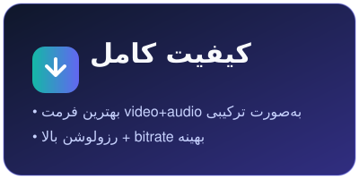
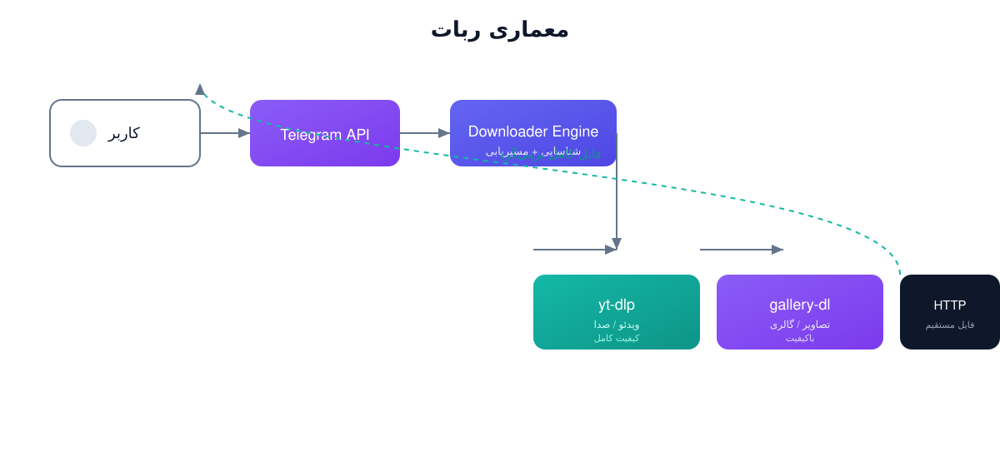
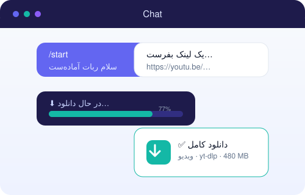
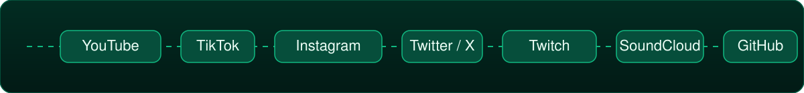

<p align="center">
  
</p>

<p align="center"><b>ربات تلگرامی دانلود همه‌جانبه با کیفیت کامل</b><br/>
<span>ویدئو · صدا · تصویر · فایل — از هزاران سایت دنیا</span></p>

<hr/>

## ✨ امکانات

<p align="center">
  
  
  
  
  
  
  
  
</p>

- **ژنریک و هوشمند** — ربات خود تشخیص می‌دهد که لینک کدام نوع رسانه است و صحن‌ترین ابزار را انتخاب می‌کند.
- **کیفیت کامل** — بهترین فرمت ترکیبی video+audio، رزولوشن بالا و bitrate بهینه (نصب `ffmpeg` الزامی است).
- **progress زنده** — پیشرفت دانلود در چهارچوب پیام به‌صورت زنده نمایش داده می‌شود.
- **چند موتور دانلود** — یک ربات، سه موتور قدرتمند (`yt-dlp`، `gallery-dl`، `HTTP`).
- **بسته و آماده** — قابل اجرا با یک دستور یا Docker.

<p align="center"></p>

<p align="center"></p>

---

## 🧠 معماری

<p align="center"></p>

ربات یک پیام می‌گیرد: لینک → شناسایی نوع → مسیریابی به موتور مناسب → دانلود → ارسال فایل.

| ستون | توضیح |
|------|-------|
| **Downloader Engine** | شناسایی URL، تشخیص نوع رسانه و مسیریابی |
| **yt-dlp** | ویدئو و صدا از YouTube، TikTok، Instagram، Twitch، Facebook، Vimeo و ده‌ها سایت دیگر |
| **gallery-dl** | تصویر و گالری از Instagram، X/Twitter، Reddit، Behance، … |
| **HTTP** | فایل‌های مستقیم و ربات‌های GitHub |

---

## 🚀 نصب و اجرا

### روش ۱:محلی (local)

<p align="center"></p>

```bash
git clone <https://github.com/devlopergit04/downloader-bot>
cd downloader-bot

python3 -m venv .venv
source .venv/bin/activate      # Windows: .venv\Scripts\activate

pip install -r requirements.txt

cp .env.example .env
# توکن TELEGRAM_BOT_TOKEN را از @BotFather بگیرش

python bot.py
```

### روش ۲: Docker

```bash
docker compose up -d --build
```

### روش ۳: یک دستور

```bash
./scripts/run.sh
```

---

## 💬 کاربرد

<p align="center"></p>

فقط یک لینک بفرست:

```
https://youtu.be/xxxx
https://instagram.com/p/xyz
https://example.com/file.zip
```

ربات فایل با کیفیت کامل و همراه با پیشرفت دانلود برات ارسال می‌کند.

### دستورات

| دستور | توضیح |
|--------|-------|
| `/start` | شروع کار |
| `/help` | نمایش دستورالعمل |
| `/ping` | تست زنده‌بودن ربات |
| `/cancel` | لغو دانلود فعلی |

---

## ⚙️ تنظیمات

همه تنظیمات از فایل `.env` خوانده می‌شوند:

| متغیر | ضروری | توضیح |
|--------|:------:|--------|
| `TELEGRAM_BOT_TOKEN` | ✅ | توکن ربات از [@BotFather](https://t.me/BotFather) |
| `ALLOWED_USER_ID` | — | شناسه‌ی کاربر مجاز (بسته‌سازی) |
| `MAX_UPLOAD_MB` | — | حداکثر حجم ارسال به چت (MB) |
| `DOWNLOAD_DIR` | — | مسیر ذخیره‌سازی ( پایه‌ی `./downloads`) |
| `YTDLP_RETRIES` | — | تعداد تلاش مجدد yt-dlp (پایه‌ی `10`) |
| `LOG_LEVEL` | — | سطح لاگ (پایه‌ی `INFO`) |

---

## 🖥️ پنل گرافیکی + Setup.exe

علاوه بر ربات تلگرام، یک **پنل گرافیکی Desktop** هم داره که مستقیم روی سیستم (Windows/macOS/Linux) اجرا می‌شه، از اینترنت دانلود می‌کنه و فایل‌ها رو به صورت لوکال ذخیره می‌کنه. می‌تونی اونش به‌صورت **Setup.exe** منتشر کنی.

**ویژگی‌های پنل:**
- اضافه‌کردنِ چند لینک با یک دستور (هر خط یک لینک)
- پیشرفت دانلود، سرعت و حجم به‌صورت زنده
- pause / resume / cancel / حذف / باز کردن folder
- تغییر مسیر ذخیره‌سازی
- تم سبز تاریک متناسب با برند

### اجرا روی سیستم (local)

```bash
pip install -r requirements.txt -r requirements-gui.txt
python -m gui.main
```

### ساخت Setup.exe (Windows)

```bash
build_windows.bat
```

این اسکریپت:
1. یک virtualenv ایجاد می‌کنه و دپىرومنت (PyQt6، yt-dlp، gallery-dl، PyInstaller) نصب می‌کنه
2. با **PyInstaller** یک `DownloaderBot.exe` single-file می‌سازه
3. با **NSIS** یک `DownloaderBot-Setup-1.0.0.exe` installer می‌سازه (shortcuts دسکتاپ + منوی استارت + uninstaller)

**پیشنیازها:** Python 3.10+ و **NSIS 3.x** (`makensis` در PATH). NSIS را از <https://nsis.sourceforge.io> بگیریرش.

### خروجی

```
dist/DownloaderBot.exe          # برنامه‌ی فشرده
DownloaderBot-Setup-1.0.0.exe   # نصب‌کننده
```

### 🚀 deploy به Railway

<p align="center">
  <a href="https://railway.com/deploy/bTZe1m" target="_blank" rel="noopener noreferrer">
    
  </a>
</p>

با کلیک روی banner، پنل گرافیکی مستقیم روی **Railway** deploy می‌شود — بدون نصب، آماده‌ی اجرا.

---

## 📁 ساختار پروژه

```
downloader-bot/
├── bot.py                # نقطه‌ی ورود و اجرای ربات
├── config.py             # تنظیمات
├── downloader/
│   ├── engine.py         # شناسایی + مسیریابی
│   ├── models.py         # مدل‌های مشترک
│   ├── ytdlp.py          # موتور ویدئو/صدا
│   ├── gallery.py        # موتور تصویر
│   └── http.py           # موتور فایل مستقیم
├── handlers/
│   ├── commands.py       # /start, /help, /ping, /cancel
│   └── messages.py       # دستیار پیام‌های متنی
├── assets/               # فایل‌های SVG تمیز و مرتب + آیکون
├── scripts/run.sh        # دستور اجرا
├── Dockerfile
├── docker-compose.yml
├── requirements.txt
├── requirements-gui.txt  # دערי PyQt6 برای پنل گرافیکی
├── gui/                  # پنل گرافیکی دانلود (PyQt6)
├── gui_main.py           # نقطه‌ی ورود برای Setup.exe
├── build/                # اسکریپت PyInstaller + NSIS Setup.exe
└── build_windows.bat     # ساخت Setup.exe با یک دستور
```

---

## 🎬 پشتیبانی‌ها

<p align="center"></p>

ربات از موتور‌های زیر پشتیبانی می‌کند:

- **YouTube** — ویدئو، صدا، thumbnail، Playlist
- **TikTok** — ویدئو بدون آب‌نگاری
- **Instagram** — ویدئو و تصویر، Reels
- **X / Twitter** — ویدئو، GIF، تصویر
- **Facebook / Twitch / Vimeo** — ویدئوی کامل
- **SoundCloud** — صدا
- **Reddit / Imgur / Behance** — تصویر و گالری
- **GitHub** — فایل Release / Repository
- **ویدئو و فایل مستقیم** از هر Domain

<p align="center">
  
</p>

---

## 📄 مستندات

- yt-dlp: <https://github.com/yt-dlp/yt-dlp>
- gallery-dl: <https://github.com/mikf/gallery-dl>
- python-telegram-bot: <https://python-telegram-bot.org>

## 📄 لایسنس

MIT — آزاد برای استفاده و تغییر.
